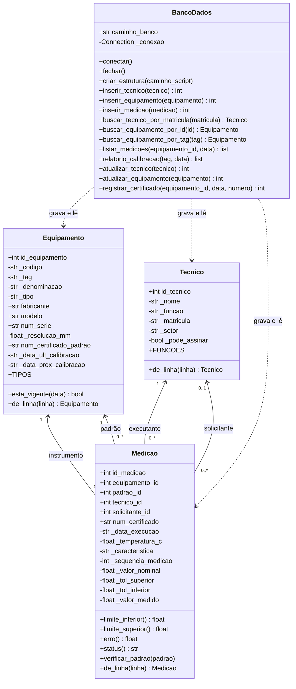

# Documentação Técnica do MVP: Parte 1

**Unidade curricular:** Projeto Aplicado I — Centro Universitário UniSENAI Santa Catarina
**AV 03 (Tema 03):** Construção do MVP, Parte 1
**Empresa parceira:** Schulz S.A.
**Grupo:** Otávio Modolon Neto, Thiago Neves Gomes, Lucas Antunes Severino

## 1. Objetivo

Na AV 02 o grupo modelou o banco SQLite com as tabelas `tecnico`, `equipamento` e `medicao`. Nesta entrega o modelo vira código: as três tabelas passam a ter uma classe correspondente em Python, e uma quarta classe concentra a conexão com o banco e os comandos SQL. O MVP ainda não lê o relatório TXT da máquina de medição; os resultados entram por um script de demonstração, com dados de teste montados a partir do certificado nº 00091/2026 analisado na Entrega 01.

A linguagem escolhida foi Python, com o módulo `sqlite3` da biblioteca padrão. Não há dependência externa: basta o Python 3.8 ou superior.

| Arquivo | Conteúdo |
|---|---|
| `04_classes.py` | Classes `Tecnico`, `Equipamento`, `Medicao` e `BancoDados`, e as exceções do sistema |
| `05_main.py` | Script de demonstração: cadastro, medições, relatório com JOIN, UPDATE e testes de erro |
| `03_banco.sql` | DDL da AV 02, executado pela classe `BancoDados` para criar o banco |

## 2. Padrões de orientação a objetos utilizados

**Encapsulamento por propriedades.** Python não tem modificador `private` como Java. A convenção é guardar o valor em um atributo com sublinhado (`_funcao`, `_codigo`) e expor o acesso por `@property`. O setter de cada propriedade é onde a validação acontece, então um objeto inválido não chega a existir: `Tecnico(nome="Teste", funcao="estagiario")` levanta erro já no construtor, antes de qualquer comando SQL.

**Atributos calculados sem setter.** Na classe `Medicao`, `erro`, `status`, `limite_inferior` e `limite_superior` são propriedades somente de leitura. Eles são calculados a partir do valor nominal, das tolerâncias e do valor medido toda vez que são lidos. Assim o status nunca fica desatualizado em relação ao valor medido, e não existe caminho para alguém digitar um status à mão, que era o que a planilha permitia.

**Separação de responsabilidades.** As três classes de domínio não conhecem SQL. Elas sabem validar os próprios dados e aplicar as regras de negócio. Toda a comunicação com o banco fica na classe `BancoDados`, que recebe e devolve objetos. Se o banco mudar de SQLite para outro, as classes de domínio não precisam ser alteradas.

**Métodos de fábrica.** Cada classe de domínio tem um `@classmethod de_linha()`, que monta o objeto a partir de uma linha lida do banco. O `SELECT` devolve objetos `Tecnico`, `Equipamento` e `Medicao`, e não tuplas soltas.

**Constantes de domínio na classe.** Os valores aceitos ficam como atributos de classe (`Tecnico.FUNCOES`, `Equipamento.TIPOS`, `Medicao.APROVADO`), os mesmos da restrição `CHECK` do `03_banco.sql`. A validação acontece duas vezes: no objeto, com mensagem clara, e no banco, como última barreira.

**Gerenciador de contexto.** A classe `BancoDados` implementa `__enter__` e `__exit__`, então pode ser usada com `with`. A conexão é fechada ao final mesmo que ocorra erro no meio da execução.

## 3. Diagrama de classes



O GitHub desenha o diagrama acima a partir do texto. A mesma estrutura em versão textual:

```
Tecnico (1) ──< executante ── (0..N) Medicao (0..N) ── instrumento >── (1) Equipamento
Tecnico (0..1) ─< solicitante ─ (0..N) Medicao (0..N) ── padrão >────── (1) Equipamento

BancoDados ── usa ──> Tecnico, Equipamento, Medicao
```

As associações seguem as quatro chaves estrangeiras da tabela `medicao`. A classe `Medicao` guarda os ids, e não os objetos, porque é assim que a linha é gravada; quando precisa do objeto, como no caso do padrão, a classe `BancoDados` busca e entrega.

## 4. Regras de negócio implementadas

| Regra | Onde fica | Como funciona |
|---|---|---|
| Status da característica | `Medicao.status` | APROVADO quando o valor medido está entre `nominal + tol_inferior` e `nominal + tol_superior`; REPROVADO fora disso |
| Limite inferior com sinal | `Medicao.limite_inferior` | A tolerância inferior já vem negativa, então o limite é `nominal + tol`. A planilha usava `nominal - tol`, o que invertia a regra |
| Padrão vigente | `Medicao.verificar_padrao` | A medição só é gravada se o padrão for do tipo padrão e estiver com a calibração válida na data de execução |
| Tolerâncias coerentes | `Medicao._definir_tolerancias` | Recusa tolerância inferior maior que a superior |
| Código só com dígitos | `Equipamento.codigo` | 500.011 e 500011 viram o mesmo código, 500011 (anomalia A13) |
| Temperatura numérica | `Medicao.temperatura_c` | Aceita o texto 20,4° da planilha e grava 20.4 (anomalia A25) |
| Datas em formato único | função `_data_iso` | Só aceita AAAA-MM-DD, com ou sem hora (anomalia A12) |
| Ausência como nulo | função `_texto_opcional` | Texto vazio vira `None`; não há marcador como `---` ou `Não consta` (anomalia A01) |
| Precisão plena | `Medicao.valor_medido` | O valor é gravado sem arredondar; o arredondamento para três casas acontece só na exibição do relatório |

Na comparação com os limites existe uma folga de 1e-9. Sem ela, um valor medido exatamente no limite, como 44,950 para nominal 45,000 e tolerância de -0,050, seria reprovado, porque em ponto flutuante `45 + (-0.05)` dá 44,94999... A folga é muito menor que a resolução de 0,001 mm do instrumento, então não muda o resultado de nenhuma medição real.

## 5. Tratamento de erros SQL

O sistema tem duas exceções próprias. `ErroValidacao` é levantada pelas classes de domínio quando o dado viola uma regra de negócio, antes de chegar ao banco. `ErroBanco` é levantada pela classe `BancoDados` quando o SQLite recusa o comando.

Todo comando de escrita passa pelo método `_executar()`, que roda o SQL dentro de `with self.conexao`. Nesse bloco o `sqlite3` faz `commit` se o comando der certo e `rollback` se der errado, então uma falha não deixa o banco pela metade. O método captura `sqlite3.IntegrityError` e traduz a mensagem técnica do SQLite em uma explicação de negócio:

| Mensagem do SQLite | Mensagem do sistema |
|---|---|
| `FOREIGN KEY constraint failed` | registro relacionado não existe no cadastro |
| `UNIQUE constraint failed: equipamento.codigo` | registro duplicado em equipamento.codigo |
| `CHECK constraint failed` | valor fora do domínio permitido pela tabela |
| `NOT NULL constraint failed: ...` | campo obrigatório sem valor |

Os demais erros do `sqlite3` (tabela inexistente, banco bloqueado, SQL inválido) também viram `ErroBanco`, com a mensagem original. A exceção original fica encadeada pelo `raise ... from erro`, o que preserva o rastro para depuração.

Dois detalhes do SQLite exigiram cuidado. O primeiro é que ele não aplica chave estrangeira por padrão: o método `conectar()` executa `PRAGMA foreign_keys = ON` em toda conexão, e sem isso as quatro FKs da tabela `medicao` seriam ignoradas. O segundo é que todos os comandos usam parâmetros `?`, nunca valores concatenados no texto do SQL, o que evita injeção de SQL e problemas com aspas em nomes.

## 6. Fluxo funcional e validação

O `05_main.py` executa o fluxo completo em seis etapas:

1. Cria o banco `certificados.db` executando o `03_banco.sql`.
2. Cadastra o executante, o setor solicitante, o instrumento de TAG 703.1208 e dois padrões, um vigente e um vencido (`INSERT`).
3. Grava dez medições: cinco características em duas execuções cada, com status calculado pela classe `Medicao` (`INSERT`).
4. Monta o relatório de calibração com uma consulta que junta `medicao`, `equipamento` duas vezes e `tecnico` duas vezes (`SELECT` com `JOIN` e `LEFT JOIN`).
5. Grava o número do certificado 00091/2026 nas dez linhas da calibração (`UPDATE`) e confere pelo `SELECT`.
6. Tenta gravar sete registros inválidos e confirma que todos são recusados.

Resultado da execução:

| Etapa | Esperado | Obtido |
|---|---|---|
| Criação do banco | 3 tabelas | 3 tabelas criadas |
| Cadastro | 2 técnicos e 3 equipamentos | 2 e 3 gravados; código 500.011 gravado como 500011 |
| Medições | 10 linhas, 8 aprovadas e 2 reprovadas | 10 gravadas; POSICAO_FURO_2 reprovada nas duas execuções (0,115 e 0,114 contra limite de 0,100) |
| Limite inferior | DISTANCIA_A_B com 44,961 aprovada | Aprovada; pela fórmula da planilha o limite seria 45,050 e a medição sairia reprovada |
| Relatório com JOIN | Cabeçalho e 10 linhas | Exibido; resultado geral REPROVADO por haver característica fora da tolerância |
| UPDATE do certificado | 10 linhas alteradas | 10 linhas com 00091/2026 |
| Padrão vencido | Recusa | ErroValidacao: padrão 500020 vencido em 2026-06-30 |
| Característica duplicada | Recusa | ErroBanco: registro duplicado (chave única composta) |
| Técnico inexistente | Recusa | ErroBanco: chave estrangeira |
| Código de equipamento repetido | Recusa | ErroBanco: registro duplicado em equipamento.codigo |
| Função fora da lista | Recusa | ErroValidacao, antes do banco |
| Tolerância invertida | Recusa | ErroValidacao, antes do banco |
| Data em formato 13/08/2026 | Recusa | ErroValidacao, antes do banco |

Também foi conferido o comportamento no limite: com nominal 45 e tolerância de ±0,050, os valores 44,950 e 45,050 saem APROVADO, e 44,9499 e 45,0501 saem REPROVADO.

## 7. Como executar

Na pasta do repositório, com Python 3.8 ou superior:

```bash
python 05_main.py
```

O script cria o arquivo `certificados.db` na pasta onde for executado. Como o `03_banco.sql` começa com `DROP TABLE IF EXISTS`, cada execução recria o banco do zero, o que é o comportamento esperado para uma demonstração.

## 8. Ajuste no script da AV 02 e limitações

Para atender ao roteiro desta entrega, o domínio da coluna `status` no `03_banco.sql` passou de `conforme`/`nao conforme` para `APROVADO`/`REPROVADO`. Foi a única mudança na estrutura do banco. O `02_dicionario.md` foi atualizado na mesma linha.

O MVP desta parte não lê o relatório TXT da máquina de medição nem gera o certificado em PDF. Esses dois passos, junto com a separação da entidade de calibração prevista na AV 02, ficam para a Parte 2.
